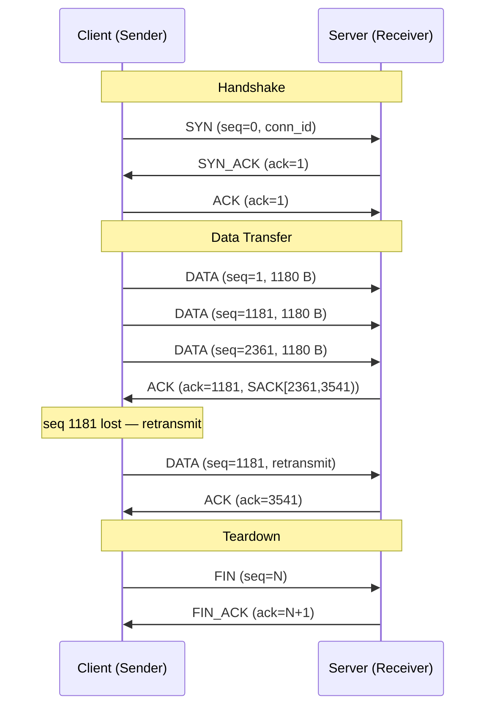
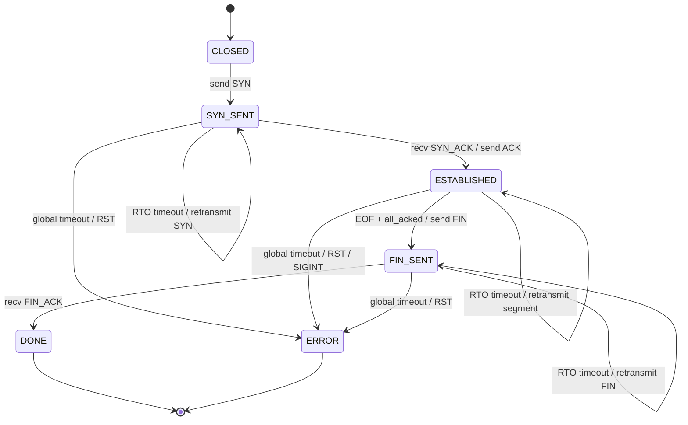
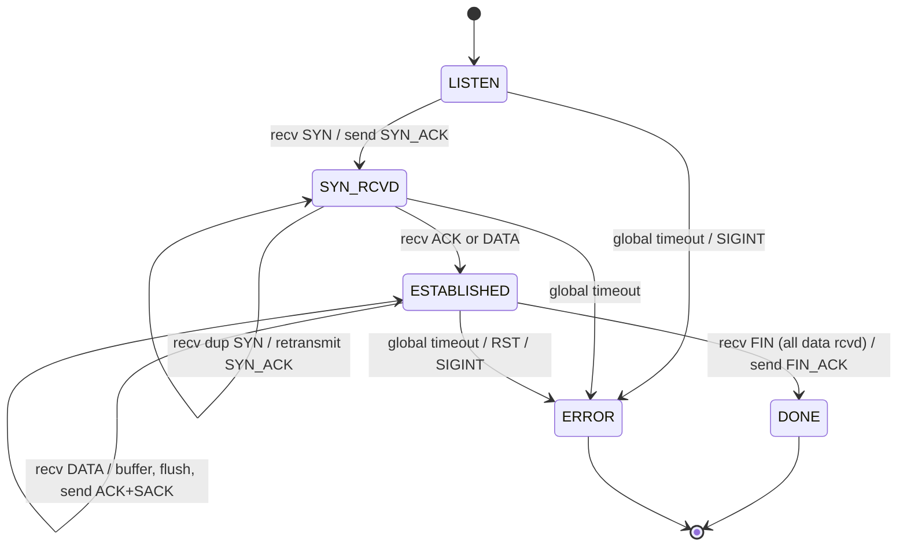
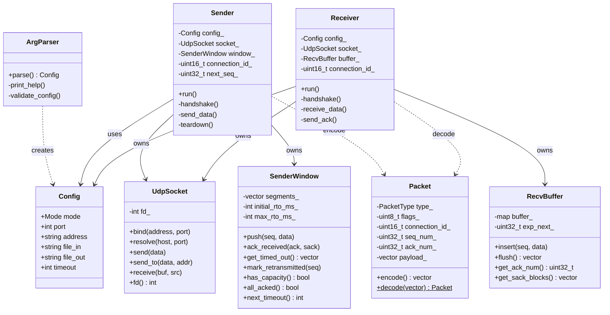

# IPK Project 2 — Reliable File Transfer over UDP (`ipk-rdt`)

**Author:** Samuel Fačka (xfackas00)
**Date:** 2026-05-02

---

## Table of Contents

1. [Project Overview](#1-project-overview)
2. [Build and Run](#2-build-and-run)
3. [Implemented Features](#3-implemented-features)
4. [Design Decisions](#4-design-decisions)
5. [Protocol Specification](#5-protocol-specification)
   - 5.1 [Packet Format](#51-packet-format)
   - 5.2 [Packet Types](#52-packet-types)
   - 5.3 [SACK Blocks](#53-sack-blocks)
   - 5.4 [CRC32 Integrity](#54-crc32-integrity)
6. [Session Lifecycle](#6-session-lifecycle)
   - 6.1 [Handshake](#61-handshake)
   - 6.2 [Data Transfer](#62-data-transfer)
   - 6.3 [Teardown](#63-teardown)
   - 6.4 [Empty Input](#64-empty-input)
7. [Sequencing and Acknowledgement](#7-sequencing-and-acknowledgement)
8. [Retransmission and Timeout](#8-retransmission-and-timeout)
9. [Duplicate and Out-of-Order Handling](#9-duplicate-and-out-of-order-handling)
10. [Connection Identification](#10-connection-identification)
11. [Segment Size and Window](#11-segment-size-and-window)
12. [FSM Diagrams](#12-fsm-diagrams)
13. [UML Diagrams](#13-uml-diagrams)
14. [Testing](#14-testing)
15. [Known Limitations](#15-known-limitations)
16. [References](#16-references)

---

## 1. Project Overview

`ipk-rdt` is a reliable unidirectional file transfer tool built on top of UDP. It implements a custom application-layer protocol that provides:

- guaranteed in-order delivery with CRC32 integrity checking
- 3-way handshake for connection establishment
- Selective Repeat ARQ with a sliding window of 32 segments
- cumulative ACK + SACK for efficient loss recovery
- per-segment exponential backoff RTO and a global progress timer
- IPv4 and IPv6 support (dual-stack receiver)

The client (`-c`) reads from a file or stdin and sends to the server. The server (`-s`) receives and writes to a file or stdout.

---

## 2. Build and Run

### Requirements

- C++20 compiler (`g++` ≥ 10 or `clang++` ≥ 12)
- GNU Make
- Linux (tested on Ubuntu 22.04)

### Build

```bash
make
```

Produces the binary `./ipk-rdt` in the repository root.

### Usage

```
./ipk-rdt -c -p PORT -a ADDRESS [-i FILE] [-w TIMEOUT]
./ipk-rdt -s -p PORT [-o FILE] [-w TIMEOUT]
./ipk-rdt -h
```

| Flag | Description | Default |
|------|-------------|---------|
| `-c` | client mode (sender) | — |
| `-s` | server mode (receiver) | — |
| `-p PORT` | UDP port (1–65535) | required |
| `-a ADDRESS` | server address or hostname (client only) | required for `-c` |
| `-i FILE` | input file (client); reads stdin if omitted | stdin |
| `-o FILE` | output file (server); writes stdout if omitted | stdout |
| `-w TIMEOUT` | inactivity timeout in seconds (> 0) | 3 |
| `-h` | print help and exit 0 | — |

### Examples

```bash
# transfer a file
./ipk-rdt -s -p 9000 -o received.bin &
./ipk-rdt -c -p 9000 -a 127.0.0.1 -i input.bin

# transfer stdin
echo "hello" | ./ipk-rdt -c -p 9000 -a ::1

# with 5-second timeout
./ipk-rdt -s -p 9000 -w 5
```

### Run tests

```bash
# end-to-end tests (test/test.sh)
make test

# unit tests (Packet, RecvBuffer, SenderWindow)
make -C test/unit_tests
```

---

## 3. Implemented Features

- **Client mode** (`-c`): reads from file (`-i`) or stdin, sends reliably to server
- **Server mode** (`-s`): binds a UDP port, receives data, writes to file (`-o`) or stdout
- **IPv4 and IPv6**: server binds a dual-stack socket (`AF_INET6 + IPV6_V6ONLY=0`), accepts both
- **3-way handshake**: SYN → SYN_ACK → ACK before any data is sent
- **Sliding window**: up to 32 unacknowledged segments in flight
- **Selective Repeat**: only lost segments are retransmitted, not the entire window
- **SACK**: receiver reports up to 3 out-of-order blocks; sender skips retransmitting them
- **CRC32**: all packets are integrity-checked; corrupt packets are silently discarded
- **Timeout handling**: global progress timer + per-segment exponential backoff RTO
- **Empty input**: handled correctly — handshake completes, FIN is sent immediately
- **Binary data**: null bytes and all byte values 0x00–0xFF are transferred correctly
- **Signal handling**: SIGINT and SIGTERM set a flag; the program exits cleanly

---

## 4. Design Decisions

| Area | Decision | Reason |
|------|----------|--------|
| ACK strategy | Cumulative ACK + SACK in ACK payload | Standard base with efficient loss recovery, no complex fixed header |
| Retransmission | Selective Repeat | Only the lost segment is retransmitted, not the entire window |
| Window size | Fixed 32 segments | Congestion control not required; simple and fast |
| RTO | Exponential backoff (RTO × 2 per timeout) | Inspired by RFC 6298 |
| Checksum | CRC32 over full packet (header + payload) | Fast, easy to implement, stronger than internet checksum |
| Connection ID | 2-byte random ID generated by the client | Protects against packet confusion between sessions |
| Handshake | 3-way (SYN → SYN_ACK → ACK) | Protects against stale retransmitted SYNs (see lecture L03) |
| Segment size | 1180 B max payload | 1200 − 20 B header = 1180 B, safely under MTU |
| Seq/ACK space | SYN and FIN each consume 1 byte | Unambiguous ACKing of control packets, same as TCP |

---

## 5. Protocol Specification

### 5.1 Packet Format

Every packet consists of a fixed 20-byte header followed by 0–1180 bytes of payload.
Maximum UDP payload: **1200 bytes**.

```
Byte offset:
 0        1        2        3
 ┌────────┬────────┬─────────────────┐
 │  type  │ flags  │    conn_id      │
 ├────────┴────────┴─────────────────┤
 │              seq_num              │  (4 B, big-endian)
 ├───────────────────────────────────┤
 │              ack_num              │  (4 B, big-endian)
 ├─────────────────┬─────────────────┤
 │   payload_len   │   (reserved)    │  (2 B + 2 B)
 ├─────────────────┴─────────────────┤
 │              checksum             │  (4 B, CRC32)
 ├───────────────────────────────────┤
 │         payload (0–1180 B)        │
 └───────────────────────────────────┘
```

| Field | Size | Description |
|-------|------|-------------|
| `type` | 1 B | PDU type (see below) |
| `flags` | 1 B | bit 0 = SACK blocks present in payload; bits 1–7 reserved |
| `conn_id` | 2 B | random session identifier generated by the client |
| `seq_num` | 4 B | byte offset of the first payload byte; SYN and FIN consume 1 virtual byte |
| `ack_num` | 4 B | next expected byte from the receiver (cumulative ACK) |
| `payload_len` | 2 B | payload length in bytes (0–1180); used to detect truncated packets |
| `reserved` | 2 B | reserved, must be 0 |
| `checksum` | 4 B | CRC32 over the full packet; field set to 0 during computation |
| payload | 0–1180 B | data bytes or SACK blocks (ACK packets only) |

A received packet is **silently discarded** if any of the following hold:

1. UDP datagram length < 20 B (incomplete header)
2. `payload_len + 20` > received length (truncated payload)
3. CRC32 mismatch (corrupted)
4. `conn_id` does not match the active session (except SYN on server)
5. Unknown `type` value

### 5.2 Packet Types

| Value | Name | Direction | Description |
|-------|------|-----------|-------------|
| `0x01` | `SYN` | C → S | session start (consumes 1 byte in seq space) |
| `0x02` | `SYN_ACK` | S → C | session acknowledgement |
| `0x03` | `DATA` | C → S | data segment |
| `0x04` | `ACK` | S → C | data acknowledgement (may carry SACK) |
| `0x05` | `FIN` | C → S | end of data (consumes 1 byte in seq space) |
| `0x06` | `FIN_ACK` | S → C | FIN acknowledgement |
| `0x07` | `RST` | both | error / session abort |

### 5.3 SACK Blocks

SACK blocks are carried in the payload of ACK packets when `flags` bit 0 is set.
Each block is 8 bytes: `sack_start` and `sack_end` (both `uint32_t`, big-endian).
Maximum 3 blocks = 24 bytes.

```
┌─────────────────┬─────────────────┐
│   sack_start    │    sack_end     │  (8 B per block)
└─────────────────┴─────────────────┘
```

`sack_start` is inclusive, `sack_end` is exclusive (half-open range).

### 5.4 CRC32 Integrity

1. Assemble the full packet (header + payload)
2. Set the `checksum` field to `0x00000000`
3. Compute CRC32 (IEEE 802.3 polynomial `0xEDB88320`) over the full buffer
4. Write the result into the `checksum` field (big-endian)

Receiver: saves the checksum, zeroes the field, recomputes, compares. Mismatch → discard.

---

## 6. Session Lifecycle

### 6.1 Handshake

```
Client                          Server
  │                               │  LISTEN
  │──── SYN (conn_id, seq=0) ────►│  SYN_RCVD
  │◄─── SYN_ACK (ack=1) ──────────│
  │──── ACK (ack=1) ─────────────►│  ESTABLISHED
  │     [data transfer]           │
```

A 3-way handshake is used to prevent stale retransmitted SYNs from opening a false session.
SYN consumes 1 byte in the sequence space — the first DATA segment has `seq=1`.

If the ACK of the handshake is lost but the client immediately sends DATA, the server accepts the first valid DATA packet as an implicit handshake ACK and transitions to ESTABLISHED. This prevents a deadlock.

### 6.2 Data Transfer

```
Client                          Server
  │──── DATA (seq=1,    1180 B) ─►│
  │──── DATA (seq=1181, 1180 B) ─►│
  │──── DATA (seq=2361, 1180 B) ─►│  ← up to 32 segments in flight
  │         ...                   │
  │◄─── ACK (ack=1181, SACK) ─────│  ← cumulative + SACK blocks
  │──── DATA (seq=...) ──────────►│  ← retransmit only lost segment
```

Sequence numbers are **byte offsets** (not segment numbers), identical to TCP.
The server sends ACK after every received DATA packet.

### 6.3 Teardown

```
Client                          Server
  │──── FIN (seq=N) ─────────────►│  ← N = 1 + total data bytes
  │◄─── FIN_ACK (ack=N+1) ────────│
  │     [both sides exit 0]       │
```

FIN consumes 1 byte in the sequence space. The client sends FIN only after all data has been sent and acknowledged.

### 6.4 Empty Input

If the input is empty (0 bytes), the client sends FIN immediately after the handshake.
The server writes 0 bytes and exits with code 0.

---

## 7. Sequencing and Acknowledgement

- `seq_num` in a DATA packet = byte offset of the first byte of its payload in the stream
- `ack_num` in an ACK packet = next expected byte (cumulative ACK)
- SYN: `seq=0`, consumes byte 0; first DATA segment has `seq=1`
- FIN: `seq=N` where N = 1 + total data length
- SACK blocks in ACK payload describe received out-of-order ranges `[start, end)`

Example: server received bytes 1–1180 and 2361–3540 (gap at 1181–2360):
- sends `ACK` with `ack_num=1181` and SACK block `[2361, 3541)`
- client retransmits only the segment at seq 1181

---

## 8. Retransmission and Timeout

Two independent timers run throughout the session:

**1. Global progress timer (`-w TIMEOUT` seconds):**
- Resets on every protocol progress event (new ACK, new DATA, handshake/teardown completion)
- Expires → exit non-zero (peer is unreachable)
- Duplicates and retransmissions do not count as progress

**2. Per-segment RTO timer:**
- Each unacknowledged segment (including SYN and FIN) has its own timer
- Initial RTO = `TIMEOUT / 4` (e.g. `-w 1` → RTO = 250 ms)
- After each timeout: `RTO = min(RTO × 2, TIMEOUT)` (exponential backoff, inspired by RFC 6298)
- Timer resets after retransmission

---

## 9. Duplicate and Out-of-Order Handling

**Receiver (server):**
- Out-of-order segments are buffered in `RecvBuffer` (a `std::map` keyed by `seq_num`)
- In-order data is flushed to output as soon as the gap is filled
- Duplicate segments (same `seq_num`) are silently ignored
- SACK blocks (up to 3) inform the sender which out-of-order ranges are already held

**Sender (client):**
- Duplicate ACKs (same `ack_num`) are ignored, window does not advance
- SACK-covered segments are marked and excluded from RTO retransmission
- Only truly lost segments (RTO expired, not SACK-covered) are retransmitted

**Edge case — FIN before all DATA:**
If the server receives FIN before all preceding DATA segments have arrived (out-of-order), it buffers the FIN seq and keeps accepting DATA. Once the cumulative ACK reaches `fin_seq`, it sends FIN_ACK and exits.

---

## 10. Connection Identification

Each session is identified by a 2-byte `conn_id` generated randomly by the client (range 1–65535, using `std::mt19937`). The `conn_id` is included in every packet. The server stores `conn_id` from the first SYN and silently drops packets with a different `conn_id`. This prevents stale packets from a previous session mixing with a new one.

---

## 11. Segment Size and Window

- **Max payload per segment:** 1180 bytes
  - Chosen as 1200 − 20 B (header) = 1180 B, keeping total UDP payload at 1200 B (safely under standard MTU)
- **Window size:** fixed 32 segments (= max 32 × 1180 = 37 760 bytes in flight)
  - Fixed window, no congestion control (not required by the assignment)
  - Window slides forward as cumulative ACKs arrive

---

## 12. FSM Diagrams

### Client (Sender)

```
┌─────────┐
│ CLOSED  │──── start / send SYN ──────────────────────────────────────►┐
└─────────┘                                                             │
                                                                        ▼
             ┌── RTO timeout: retransmit SYN, RTO×2          ┌─────────────────┐
             └──────────────────────────────────────────────►│    SYN_SENT     │
                                                             └────────┬────────┘
                                                                      │ recv SYN_ACK / send ACK
                                                                      ▼
             ┌── recv ACK: advance window                    ┌─────────────────┐
             ├── recv SACK: mark segments                 ┌──┤   ESTABLISHED   │
             ├── RTO timeout: retransmit seg., RTO×2      └─►└────────┬────────┘
             └──────────────────────────────────────────────────────  │
                                                      EOF + all_acked │ / send FIN
                                                                      ▼
             ┌── RTO timeout: retransmit FIN, RTO×2          ┌─────────────────┐
             └──────────────────────────────────────────────►│    FIN_SENT     │
                                                             └────────┬────────┘
                                                                      │ recv FIN_ACK
                                                                      ▼
                                                             ┌─────────────────┐
                                                             │      DONE       │
                                                             └─────────────────┘
      global timeout / RST / SIGINT → ERROR  (from any state)
```

### Server (Receiver)

```
┌─────────┐
│  LISTEN │──── recv SYN / send SYN_ACK ──────────────────────────────►┐
└─────────┘                                                            │
                                                                       ▼
          ┌── RTO timeout: retransmit SYN_ACK, RTO×2          ┌────────────────┐
          ├── recv dup. SYN: retransmit SYN_ACK            ┌──┤   SYN_RCVD     │
          └──────────────────────────────────────────────► └─►└───────┬────────┘
                                                                      │ recv ACK / recv DATA
                                                                      ▼
          ┌── recv DATA: buffer, flush, send ACK+SACK         ┌─────────────────┐
          ├── recv dup. DATA: send ACK                    ┌───┤   ESTABLISHED   │
          └────────────────────────────────────────────── └──►└─────────┬───────┘
                                                                        │ recv FIN (all data rcvd)
                                                                        │ flush / send FIN_ACK
                                                                        ▼
                                                               ┌─────────────────┐
                                                               │      DONE       │
                                                               └─────────────────┘
      global timeout / RST / SIGINT → ERROR  (from any state)
```

---

## 13. UML Diagrams

### Sequence Diagram — full session



### State Machine — Client (Sender)



### State Machine — Server (Receiver)



### Class Diagram



---

## 14. Testing

### Environment

**End-to-end tests** were run on:

- Machine: UTM virtual machine
- OS: Ubuntu 24.04 LTS
- Kernel: 6.8.0-106-generic
- Compiler: g++ 13.3.0 (Ubuntu 13.3.0-6ubuntu2~24.04.1)
- Architecture: x86_64

**Unit tests** were developed and run on:

- Machine: MacBook Pro M4 Pro, 24 GB RAM
- OS: macOS (Apple Silicon)
- Compiler: Apple Clang (C++20)

### End-to-End Tests (`test/test.sh`)

Run with:

```bash
make test
```

The test script starts a receiver in the background and a sender in the foreground on localhost, then compares inputs and outputs using `cmp`.

| # | What was tested | Why | How | Expected | Actual |
|---|-----------------|-----|-----|----------|--------|
| 1 | Argument parsing (11 sub-cases) | Reject invalid CLI usage early | Run binary with invalid/missing flags, check exit codes and stderr | Exit 1 + error message | PASS |
| 2 | Small string transfer (`hello world`) | Basic end-to-end correctness | Pipe string to sender → receiver → check output | Output == input | PASS |
| 3 | Empty input (0 bytes) | Edge case: empty file must produce empty output | `echo -n ""` piped to sender | Output file size == 0, both exit 0 | PASS |
| 4 | File transfer via `-i`/`-o` flags | Verify file I/O flags work correctly | Small file, compare with `cmp` | Files identical | PASS |
| 5 | 1 MB random file | Verify large multi-segment transfer | `dd if=/dev/urandom`, compare with `cmp` | Files identical | PASS |
| 6 | Multiline text | Verify newlines and text data are preserved | `printf "line1\nline2\nline3\n"` | Files identical | PASS |
| 7 | Sender timeout (no server running) | Verify sender exits non-zero within timeout | Run sender with `-w 1`, no server | Exit 1, elapsed ≤ 3 s | PASS |
| 8 | IPv6 loopback (`::1`) | Verify dual-stack receiver accepts IPv6 | Send via `::1`, receive on dual-stack socket | Output == input | PASS |
| 9 | 1-byte transfer | Minimal non-empty input edge case | `printf 'X'` piped to sender | Output == `X` | PASS |
| 10 | Exactly 1180 bytes (MAX_PAYLOAD) | Single-segment boundary | `dd bs=1180 count=1` | Files identical | PASS |
| 11 | 1181 bytes (MAX_PAYLOAD + 1) | Forces exactly 2 segments | `dd bs=1181 count=1` | Files identical | PASS |
| 12 | Binary data (0x00–0xFF) | Verify null bytes and all byte values are handled | Python generates 256-byte file | Files identical | PASS |
| 13 | Receiver stdout (no `-o`) | Verify output defaults to stdout | Redirect receiver stdout to file | Output == input | PASS |
| 14 | Receiver timeout (no sender) | Verify receiver exits non-zero within timeout | Run receiver with `-w 1`, no sender | Exit 1, elapsed ≤ 3 s | PASS |
| 15 | 10 MB file | Verify large file transfer across many windows | `dd bs=1024 count=10240` | Files identical | PASS |
| 16 | 37 760 bytes (32 × MAX_PAYLOAD) | Fills exactly one full sliding window | `dd bs=37760 count=1` | Files identical | PASS |

```
=================================
 ipk-rdt — End-to-End Test Suite
=================================

--- [1] Argument parsing ---
PASS: -h prints usage
PASS: -h exits 0
PASS: no arguments exits 1
PASS: -c without -p exits 1
PASS: -s without -p exits 1
PASS: -c without -a exits 1
PASS: no mode flag exits 1
PASS: -c and -s together exits 1
PASS: port 0 exits 1
PASS: port 99999 exits 1
PASS: non-numeric port exits 1
PASS: timeout 0 exits 1
PASS: unknown argument exits 1

--- [2] Basic transfer (small string) ---
PASS: sender exits 0
PASS: receiver exits 0
PASS: output contains transferred data

--- [3] Empty input ---
PASS: sender exits 0 on empty input
PASS: receiver exits 0 on empty input
PASS: output file is empty

--- [4] File transfer (-i / -o) ---
PASS: sender exits 0 (file input)
PASS: receiver exits 0 (file output)
PASS: input and output files are identical

--- [5] Large file transfer (1 MB) ---
PASS: sender exits 0 (1 MB)
PASS: receiver exits 0 (1 MB)
PASS: 1 MB file transferred correctly

--- [6] Multiline text ---
PASS: sender exits 0 (multiline)
PASS: receiver exits 0 (multiline)
PASS: multiline text transferred correctly

--- [7] Timeout (no server) ---
Error: Handshake timeout
PASS: sender exits non-zero when no server
PASS: sender timed out within expected window (1s)

--- [8] IPv6 loopback (::1) ---
PASS: sender exits 0 (IPv6)
PASS: receiver exits 0 (IPv6)
PASS: IPv6 transfer output correct

--- [9] 1-byte transfer ---
PASS: sender exits 0 (1-byte)
PASS: receiver exits 0 (1-byte)
PASS: 1-byte output correct

--- [10] Exactly MAX_PAYLOAD bytes (1180) ---
PASS: sender exits 0 (1180 B)
PASS: receiver exits 0 (1180 B)
PASS: 1180-byte file transferred correctly

--- [11] MAX_PAYLOAD+1 bytes (1181, forces 2 segments) ---
PASS: sender exits 0 (1181 B)
PASS: receiver exits 0 (1181 B)
PASS: 1181-byte file transferred correctly

--- [12] Binary data (0x00-0xFF) ---
PASS: sender exits 0 (binary)
PASS: receiver exits 0 (binary)
PASS: binary data transferred correctly

--- [13] Receiver stdout (no -o) ---
PASS: sender exits 0 (stdout)
PASS: receiver exits 0 (stdout)
PASS: stdout output correct

--- [14] Receiver timeout (no sender) ---
Error: Handshake timeout
PASS: receiver exits non-zero when no sender
PASS: receiver timed out within expected window (1s)

--- [15] Large file transfer (10 MB) ---
PASS: sender exits 0 (10 MB)
PASS: receiver exits 0 (10 MB)
PASS: 10 MB file transferred correctly

--- [16] Full window transfer (32 × MAX_PAYLOAD = 37760 B) ---
PASS: sender exits 0 (full window)
PASS: receiver exits 0 (full window)
PASS: full-window file transferred correctly

=================================
 Results: 56 passed, 0 failed
=================================
```

### Unit Tests (`test/unit_tests/`)

Run with:

```bash
make -C test/unit_tests
```

Three test binaries are built and run:

#### `test_packet` — Packet encode/decode and CRC32

Tests cover: SYN/DATA/ACK+SACK/FIN/SYN_ACK/FIN_ACK round-trips, max payload (1180 B), large seq/ack values (uint32 boundary), connection_id at 0 and 65535, CRC32 corruption detection, too-short packet rejection, unknown type rejection, truncated payload rejection.

#### `test_recv_buffer` — RecvBuffer reorder logic

Tests cover: initial state, in-order delivery, out-of-order delivery with gap filling, duplicate segment ignored, old segment (before `exp_next_`) ignored, SACK blocks (1, 2, 3 blocks, max 3), multiple separate flushes, 1-byte segments, duplicate seq with different data, flush stops at first gap.

#### `test_sender_window` — SenderWindow sliding window logic

Tests cover: initial capacity, push until full (32 segments), cumulative ACK removes segments, SACK marking excludes segments from retransmission, RTO expiry detection, `mark_retransmitted` resets timer, `next_timeout` positive after push, exponential backoff doubles RTO, multiple SACK blocks, window slides after partial ACK, ACK on exact segment boundary, all_acked after partial then full ACK.

```
=== Packet unit tests ===

[PASS] SYN type
[PASS] SYN flags
[PASS] SYN connection_id
[PASS] SYN seq_num
[PASS] SYN ack_num
[PASS] SYN payload empty
[PASS] DATA type
[PASS] DATA connection_id
[PASS] DATA seq_num
[PASS] DATA payload size
[PASS] DATA payload content
[PASS] ACK+SACK type
[PASS] ACK+SACK has_sack
[PASS] ACK+SACK ack_num
[PASS] corrupted CRC throws
[PASS] too short throws
[PASS] FIN type
[PASS] FIN seq_num
[PASS] FIN payload empty
[PASS] unknown type throws
[PASS] truncated payload throws
[PASS] SYN_ACK type
[PASS] SYN_ACK ack_num
[PASS] SYN_ACK conn_id
[PASS] FIN_ACK type
[PASS] FIN_ACK ack_num
[PASS] max payload size
[PASS] max payload content
[PASS] large seq_num preserved
[PASS] large ack_num preserved
[PASS] conn_id 0 preserved
[PASS] conn_id 65535 preserved

=== Results: 32 passed, 0 failed ===

=== SenderWindow unit tests ===

[PASS] initial has_capacity
[PASS] initial all_acked
[PASS] has_capacity before full       (× 32)
[PASS] no capacity when full
[PASS] not all acked when full
[PASS] cumulative ACK removes confirmed segments
[PASS] one segment remains
[PASS] all acked after full ACK
[PASS] SACK'd segment not retransmitted
[PASS] segment timed out after RTO
[PASS] timed out segment has correct seq
[PASS] segment not timed out after retransmit reset
[PASS] next_timeout positive after push
[PASS] next_timeout <= initial RTO (250ms)
[PASS] segment timed out before retransmit
[PASS] next_timeout doubled after retransmit
[PASS] multiple SACK'd segments not retransmitted
[PASS] window full
[PASS] capacity restored after partial ACK
[PASS] not all acked yet
[PASS] all acked after full ACK
[PASS] segment removed on exact boundary ACK
[PASS] not all acked after partial
[PASS] not all acked after second partial
[PASS] all acked after full

=== Results: 56 passed, 0 failed ===

=== RecvBuffer unit tests ===

[PASS] initial ack_num is 1
[PASS] initial flush is empty
[PASS] initial sack_blocks empty
[PASS] in-order flush size
[PASS] in-order flush content
[PASS] ack_num after flush
[PASS] out-of-order flush empty before gap filled
[PASS] ack_num unchanged
[PASS] flush after gap filled
[PASS] ack_num after gap filled
[PASS] duplicate ignored, size correct
[PASS] ack_num correct after duplicate
[PASS] old segment ignored
[PASS] ack_num unchanged
[PASS] max 3 sack blocks
[PASS] sack block 1 start
[PASS] sack block 1 end
[PASS] sack block 2 start
[PASS] sack block 2 end
[PASS] sack block 3 start
[PASS] sack block 3 end
[PASS] empty flush returns empty vector
[PASS] first flush size
[PASS] ack_num after first flush
[PASS] second flush size
[PASS] ack_num after second flush
[PASS] third flush size
[PASS] ack_num after third flush
[PASS] three 1-byte segments size
[PASS] 1-byte segment content
[PASS] ack_num after 1-byte segments
[PASS] second insert with same seq ignored
[PASS] one out-of-order = one sack block
[PASS] sack block start
[PASS] sack block end
[PASS] two sack blocks
[PASS] block 1 start
[PASS] block 1 end
[PASS] block 2 start
[PASS] block 2 end
[PASS] flush stops before gap
[PASS] ack_num stops at gap
[PASS] sack block for segment after gap

=== Results: 43 passed, 0 failed ===
```

---

## 15. Known Limitations

- No congestion control — the window size is fixed at 32 segments regardless of network conditions.
- Single client per server instance — the server handles exactly one connection per run.
- Unidirectional transfer only — data flows from client to server.
- No transfer resume — if interrupted, the transfer must be restarted from the beginning.
- No encryption or authentication.
- RST handling is defined in the FSM but is not actively sent on all error paths in the current implementation.

---

## 16. References

PAXSON, V., ALLMAN, M., CHU, J. and SARGENT, M. *Computing TCP's Retransmission Timer* [online]. RFC 6298. Fremont: IETF, June 2011. Available at: https://www.rfc-editor.org/rfc/rfc6298. [cit. 2026-04-28].

IEEE. *IEEE Standard for Ethernet — CRC32 (polynomial 0xEDB88320)* [online]. IEEE 802.3. New York: IEEE, 2022. Available at: https://standards.ieee.org/ieee/802.3. [cit. 2026-04-27].

The Open Group. *poll(2) — input/output multiplexing* [online]. POSIX.1-2017. The Open Group, 2018. Available at: https://pubs.opengroup.org/onlinepubs/9699919799/functions/poll.html. [cit. 2026-04-28].

The Open Group. *getaddrinfo(3) — network address and service translation* [online]. POSIX.1-2017. The Open Group, 2018. Available at: https://pubs.opengroup.org/onlinepubs/9699919799/functions/getaddrinfo.html. [cit. 2026-04-28].

The Open Group. *socket(2), bind(2), recvfrom(2), sendto(2) — POSIX socket API* [online]. POSIX.1-2017. The Open Group, 2018. Available at: https://pubs.opengroup.org/onlinepubs/9699919799/functions/socket.html. [cit. 2026-04-28].

The Open Group. *sigaction(2) — examine and change a signal action* [online]. POSIX.1-2017. The Open Group, 2018. Available at: https://pubs.opengroup.org/onlinepubs/9699919799/functions/sigaction.html. [cit. 2026-04-28].

The Open Group. *htons(3), htonl(3), ntohs(3), ntohl(3) — convert values between host and network byte order* [online]. POSIX.1-2017. The Open Group, 2018. Available at: https://pubs.opengroup.org/onlinepubs/9699919799/functions/htonl.html. [cit. 2026-04-28].

ANTHROPIC. *Claude* [online]. San Francisco: Anthropic, 2025. Available at: https://claude.ai. [cit. 2026-05-03]. This project was developed with the assistance of Claude (Anthropic). AI assistance was used in the planning and design of the transport protocol, packet format, and software architecture. Unit tests and test suite were also developed with AI assistance.
